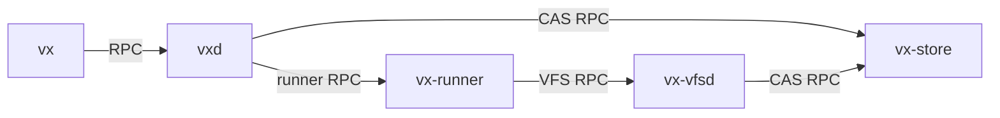

+++
title = "Daemon Topologies"
insert_anchor_links = "heading"
+++

vixen is a multi-process system. The `vx` CLI talks to `vxd` (the coordinator),
and `vxd` manages worker services.

Daemon RPC uses [roam](https://roam.bearcove.eu/), which is built on
[facet](https://facet.rs).

## Connect mode (`VXD` is set)

When `VXD` is set, `vx` only tries to connect to that endpoint.

Examples:

- `unix:/home/jane/.vx/vxd.sock`
- `tcp://10.200.0.4:9449`

If the daemon is unreachable, `vx` exits with an error. It does not try to
spawn a fallback daemon in this mode.

## Bootstrap mode (`VXD` is not set)

When `VXD` is not set, `vx` targets a local endpoint at
`$VX_HOME/vxd.sock` (default: `~/.vx/vxd.sock`).

- If `vxd` is already running, `vx` connects to it.
- If not, `vx` spawns `vxd` locally.
- `vxd` then ensures `vx-store` and `vx-runner` are available (connects to
  `VX_STORE` / `VX_RUNNER` when provided, otherwise spawns local daemons).

Local transports are Unix domain sockets on Linux/macOS and named pipes on
Windows.

## Lifecycle

`vxd` tracks active client connections and shuts itself down after an idle
period:

- Production mode: 2 hours
- Test mode (`VX_TEST=1`): 2 seconds

In test mode, `vxd` also watches the test harness process and exits as soon as
the harness exits.

Children spawned through the service launcher are tied to their parent process
via [`ur-taking-me-with-you`](https://crates.io/crates/ur-taking-me-with-you),
so they terminate when the parent disappears.

## Logging behavior

Logging differs by mode:

- Normal mode: daemon stdout/stderr is redirected to log files under `VX_HOME`
- Test mode (`VX_TEST=1`): daemon stdout/stderr is inherited by the current
  terminal or captured by the explicit scenario runner (useful in CI and
  `cargo run -p xtask -- integration run`)

## Multiplexing across tests

Parallel tests can race to start `vxd`. The daemon uses a lock file
(`vxd.lock` in `VX_HOME`) to ensure only one instance becomes primary, and
other contenders connect to the active instance.

## Virtual filesystem daemon (`vx-vfsd`)

`vx-vfsd` runs VFS operations in a separate process from `vx-runner` to reduce
tight coupling and simplify failure handling.

- `vx-runner` tells `vx-vfsd` what to mount and what outputs to flush
- `vx-vfsd` reads and writes content through `vx-store`

Platform notes:

- Linux: FUSE-based VFS, including sentinel-based cleanup for parent death
- macOS: FSKit integration via helpers shipped in [Vixen mac app](/vixen-mac-app/)
- Windows: ProjFS backend is present; sentinel-mode cleanup is not yet supported
