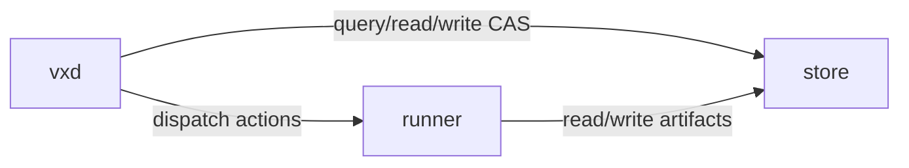
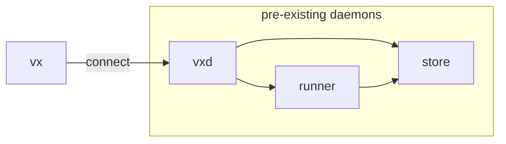
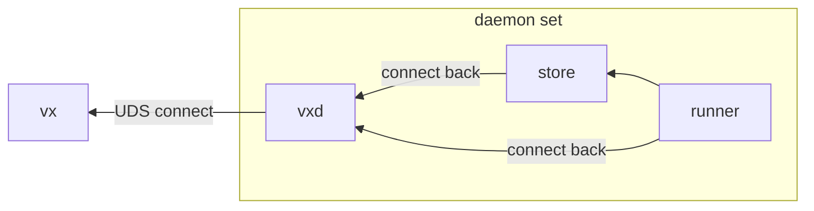

+++
title = "Daemon Topologies"
insert_anchor_links = "heading"
+++

The vixen build system runs as a fleet of daemons, and one CLI front, `vx`.

All those daemons talk to each other using [roam](https://roam.bearcove.eu/), an
RPC system built on top of [facet](https://facet.rs)

This page describes who starts those demons, when, how, and for how long? 

## Connect Mode

If the `VXD` environment variable is set, `vx` connects to an existing
daemon over whatever transport is defined by the address, e.g. `VXD` can be
something like:

  * `unix://home/jane/.vx/vxd.sock`
  * `tcp://10.200.0.4:9449`

If `vx` cannot connect on the first try, it immediately exits with an error.

## Bootstrap Mode

If the `VXD` environment variable is _not_ set, `vx` starts in bootstrap mode: it'll attempt
to start all necessary daemons under `VX_HOME` (or `{home-dir}/.vx`, failing that, and yes it
respects XDG).

Because it's starting all daemons locally, it will prefer Unix domain sockets on
Linux and Mac, and named pipes on Windows. 

In this scenario the direction is reversed. Instead of starting `vxd` and waiting
for it to listen, vx listens on an address and instructs `vxd` to connect to it.

> Because in roam RPC the there's no link between the requester and the connection initiator,
> this works fine.

### Standard output and error streams

When running in Bootstrap mode, it is okay for all of vxd's descendants to
inherit its standard error and output streams — therefore, instead of logging to
files, all the output is available in the terminal or CI output when running
tests. 

### Spawned daemon lifecycle

When started by `vx` normally, `vxd` lives up to six hours after the last connection drops.

All its descendants use the
[ur-taking-me-with-you](https://crates.io/crates/ur-taking-me-with-you) crate to make sure
that they die when their parent dies, no matter what.

When running tests, we don't actually want vxd to survive that long, so we tie its lifetime
to the test runner, `cargo-nextest`, by setting `VXD_DEATH_PACT_PID={cargo-nextest-pid}`.

This is achieved by a [nextest setup script](https://nexte.st/docs/configuration/setup-scripts/?h=setup)

### Multiplexing

Even though in tests, VXD runs a relatively short amount of time, it is shared
across different tests, which all run in their own processes. 

Therefore, there is a race for the first `vx` to spawn `vxd`.

## The virtual filesystem

The diagrams presented above are not fully accurate. They are missing the VFS
daemon. Those handle FUSE ops, FSKit operations, ProjFS... functions? From a process
distinct from `vx-runner`, to avoid deadlocks.

> `vx-vfsd` is connected to both `vx-runner` (which tells it what to mount and where)
> and to `vx-store` (since you can mount entire store trees inside the VFS without
> transferring them eagerly to vx-vfsd).

### VFS cleanup per platform

On Linux, the vfs daemon forks itself to await its doppelganger's death and
clean up the FUSE mount gracefully.

On Windows uh... the ProjFS PR is not merged yet at the time of this writing.
I'm not sure what the plan is.

On macOS, the `vixenfs-mount` helper (provided by the [Vixen mac app](vixen-mac-app))

## Pending renames

`vxd` breaks the `vx-{role}` pattern, it could be `vx-coord`, `vx-lead`, `vx-chef`,
a number of things.

`vx-vfsd` kind of a mouthful and has 'd' at the end, how about `vx-fs`, or `vx-filesystem`.
