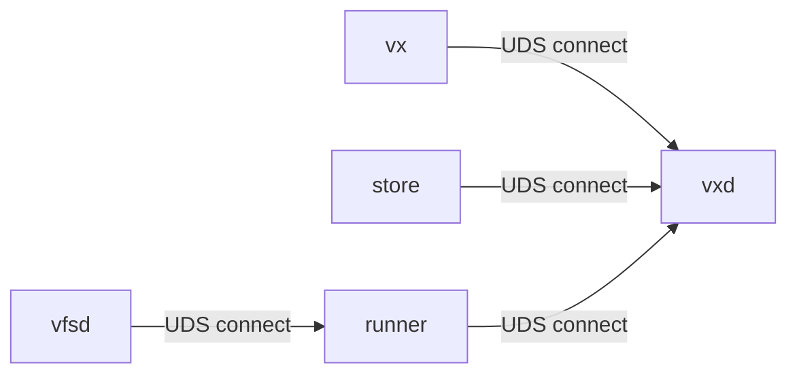
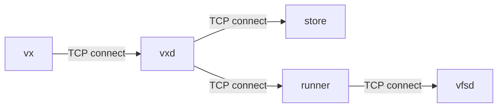
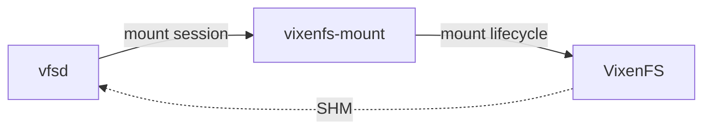

+++
title = "Daemon Topologies"
insert_anchor_links = "heading"
+++

This page defines how vixen daemons are expected to run in different
environments.

## Two Models

vixen supports two operational models:

- Local model: everything runs on your machine, typically for development and tests.
- Distributed model: one or more daemons run remotely and are already provisioned.

The model is selected by endpoint configuration, not by changing RPC semantics.

## Process Relationship Graph

### Local Model

- Connection initiators (local): `vx -> vxd`, `store -> vxd`, `runner -> vxd`, `vfsd -> runner`.
- Local transport is `UDS` (or named pipes on non-Unix platforms).
- `vxd` owns the local `VX_HOME` lock scope.
- In local topology, children die with their parent.

### Distributed Model

- Connection initiators (distributed): `vx -> vxd`, `vxd -> store`, `vxd -> runner`, `runner -> vfsd`.
- Transport is `TCP`.
- Services are pre-provisioned by external orchestration (no local spawn assumptions).

## Connection Direction and Roam RPC

Connection initiator does not change RPC semantics in Roam.

- Whether parent dials child or child dials parent, the protocol surface is the same.
- The transport can be UDS/named pipe or TCP.
- The logical contract is defined by service interfaces, not socket initiator direction.

This is why local and distributed models can share the same protocol definitions while differing in bootstrap and lifecycle behavior.

## macOS VFS Lifetime

On macOS, treat `vixenfs-mount` and `VixenFS` as different lifecycle domains.

- `vixenfs-mount` owns mount/unmount session lifecycle.
- `VixenFS` is OS-managed capability (not daemon child topology).
- `vfsd` <-> `VixenFS` data path is `SHM`.

## Design Invariants

- No retry backoff loops as a substitute for lifecycle design.
- Local startup should be event/registration-driven, not sleep/poll-driven.
- Remote endpoints are treated as externally managed infrastructure.
- `VX_HOME` locking is a local ownership mechanism, not a remote coordination mechanism.

## Environment Variables

- `VX_HOME`: Base home for local runtime state (sockets, logs, caches, lock ownership scope).
- `VXD`: `vxd` endpoint for `vx` to connect to.
- `VX_STORE`: `vx-store` endpoint for `vxd`.
- `VX_RUNNER`: `vx-runner` endpoint for `vxd`.
- `VX_RUNNER_HOST_TRIPLE`: Required when `VX_RUNNER` is remote so `vxd` can request the correct toolchain target.

Endpoint values may be local (Unix socket / named pipe) or remote (TCP), depending on deployment model.

## CLI Flags

### `vx`

- `vx build --no-spawn`: Never auto-spawn `vxd`; connect only.
- `vx build --no-tui`: Disable TUI progress UI.
- `vx build --json`: Emit NDJSON progress/events.

### `vxd`

- `vxd --vx-home <path>`: Set daemon home root.
- `vxd --listen <endpoint>`: Bind endpoint for `vx` clients.
- `vxd --store <endpoint>`: `vx-store` endpoint.
- `vxd --runner <endpoint>`: `vx-runner` endpoint.

### `vx-store`

- `vx-store --listen <endpoint>`: Bind store RPC endpoint.
- `vx-store --root <path>`: CAS storage root.
- `vx-store --vx-home <path>`: Home root for store-related state.

### `vx-runner`

- `vx-runner --listen <endpoint>`: Bind runner RPC endpoint.
- `vx-runner --store <endpoint>`: `vx-store` endpoint.
- `vx-runner --vfsd <endpoint>`: `vx-vfsd` endpoint.
- `vx-runner --vx-home <path>`: Home root for runner-related state.

### `vx-vfsd`

- `vx-vfsd --listen <endpoint>`: Bind VFS daemon RPC endpoint.
- `vx-vfsd --mount <path>`: VFS mount point.
- `vx-vfsd --store <endpoint>`: `vx-store` endpoint.
