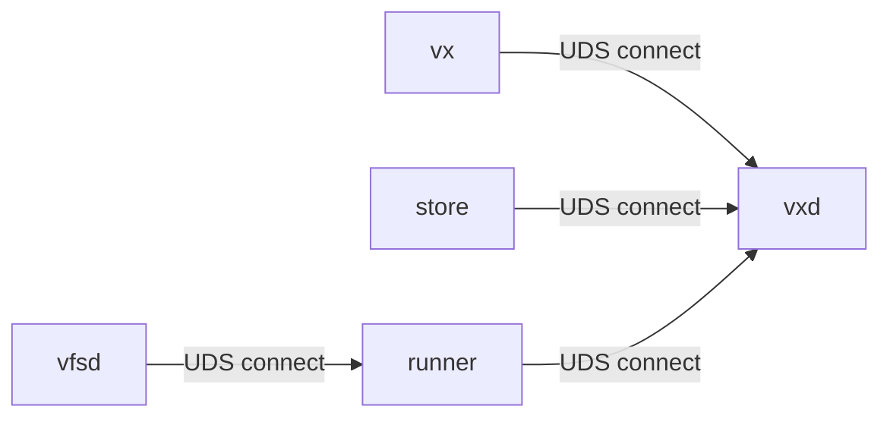
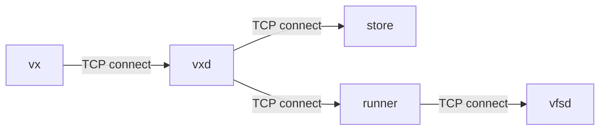
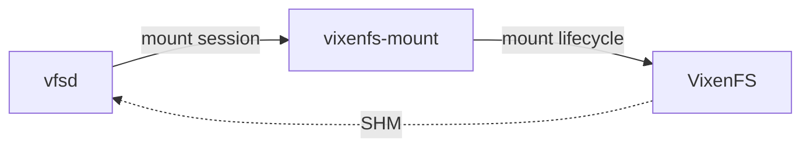

+++
title = "Daemon Topologies"
insert_anchor_links = "heading"
+++

This page defines daemon topology and connection direction in vixen.

## What This Page Is About

vixen is a multi-daemon build system. Core components (`vxd`, `store`, `runner`,
`vfsd`) can run locally or remotely, and all component-to-component calls use
Roam RPC.

Two useful extremes:

- Local-first: everything on one machine (`UDS` / named pipes), easy dev/test.
- Distributed: services pre-provisioned across hosts (`TCP`), better scaling.

You can mix and match in between. For example, `store` can be local, remote,
backed by S3-like cloud storage, or backed by shared storage like NFS.

## Roam RPC Invariant

Roam does not care who initiated a connection.

- Interface semantics are the same regardless of dial direction.
- Transport can be local (`UDS` / named pipes) or remote (`TCP`).
- Bootstrap direction may differ from steady-state call direction.

This is the key reason one protocol surface can support both local and
distributed deployment models.

## Daemon Roles

- `vx`: user-facing CLI entrypoint; resolves endpoints and starts build requests.
- `vxd`: orchestration/control plane; coordinates build graph execution.
- `store`: content-addressed storage and toolchain/materialization backend.
- `runner`: execution worker for compile/link actions.
- `vfsd`: VFS service endpoint used by `runner`.
- macOS only: `vixenfs-mount` manages mount session lifecycle; `VixenFS` is
  OS-managed FSKit extension.

## Endpoint And Socket Model

In local mode, endpoint namespace lives under `VX_HOME`.

- `VX_HOME` is the root for local runtime state.
- Default local sockets are under `VX_HOME` (typically `*.sock` endpoints like
  `vxd`, `store`, `runner`, `vfsd`).
- Endpoint env vars can override defaults: `VXD`, `VX_STORE`, `VX_RUNNER`.

For local daemons, resolved endpoints are propagated via CLI arguments, not
hardcoded discovery:

- `vxd` starts children with explicit flags such as `--listen`, `--store`,
  `--runner`, `--vfsd`, `--vx-home`, `--root`, `--mount`.

In distributed mode, these endpoints are usually TCP addresses.

## What Happens When `vx` Starts

When `vx` is invoked:

1. `vx` resolves target endpoint(s) from CLI/env/defaults.
2. `vx` attempts to reach `vxd`.
3. If `vxd` is already up, `vx` connects directly and sends the request.
4. If `vxd` is not up and local bootstrap is allowed, `vx` starts `vxd` with
   explicit endpoint configuration.
5. `vxd` ensures `store` / `runner` / `vfsd` topology is available.
6. Build execution proceeds over Roam RPC.

Important: bootstrap may involve one direction, while steady-state operation may
use another. Roam semantics are unchanged.

## Connection Direction By Mode

### Local Model

- Connection direction focuses on who dials whom.
- Transport is local (`UDS` / named pipes).
- `vxd` owns local `VX_HOME` lock scope.
- In local topology, child lifetimes are tied to parent lifetimes.

### Distributed Model

- Services are pre-provisioned by external orchestration.
- Transport is `TCP`.
- No local auto-spawn assumptions.

## macOS VFS Lifetime

- `vixenfs-mount` owns per-session mount/unmount behavior.
- `VixenFS` is OS-managed capability, not a daemon child.
- `vfsd` <-> `VixenFS` data path uses `SHM`.

## Topology Knobs

### Environment Variables

- `VX_HOME`: local runtime root (sockets, logs, caches, lock scope).
- `VXD`: `vxd` endpoint for `vx`.
- `VX_STORE`: `store` endpoint for `vxd`.
- `VX_RUNNER`: `runner` endpoint for `vxd`.
- `VX_RUNNER_HOST_TRIPLE`: required when `VX_RUNNER` is remote.

### CLI Flags

- `vx build --no-spawn`: connect-only mode; do not auto-start `vxd`.
- `vxd --listen --store --runner --vx-home`: control-plane endpoint/home config.
- `vx-store --listen --root --vx-home`: store endpoint/storage config.
- `vx-runner --listen --store --vfsd --vx-home`: runner connectivity config.
- `vx-vfsd --listen --mount --store`: VFS daemon endpoint/mount/store config.

## Invariants

- No sleep/backoff loops as lifecycle strategy.
- Lifecycle should be event/registration-driven.
- `VX_HOME` lock semantics are local, not distributed orchestration.
