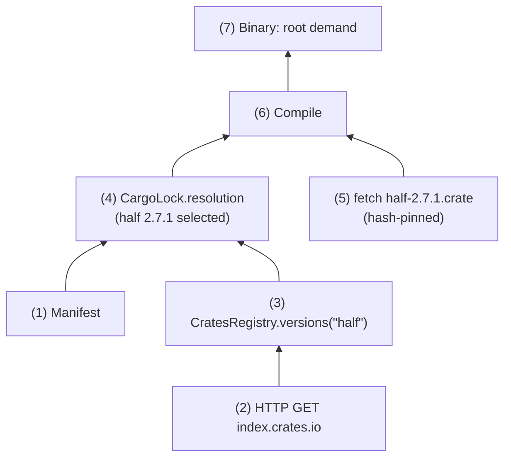

Vix is a dataflow language masquerading as a pure functional language. It
unifies values—expressions and computations—with artifacts—files and
processes—into a single graph that can be cached at surprisingly many points and
scheduled across machines.

Vix is meant to make it trivial to describe Bazel-like build graphs naturally —
sandboxed, hermetic, distributed, cache-shared, CAS-backed — but also to
implement language-specific build tools like Cargo: HTTP, package resolution,
decompression, compilation, etc., without losing distributed execution and
caching.

Vix is the language compilers, bundlers, LSP servers, and anything else doing
partial recomputation should have been written in.

## Values

Evaluating a Vix expression any number of times yields the same value.
Evaluation may therefore be deduplicated, scheduled with arbitrary concurrency
against other evaluations, cached, even cached *remotely*.

> r[vix.values]
>
> All values are hashable and have a total ordering.
>
> Unlike Rust's `derive(Ord)` and `derive(Hash)`, neither depends on
> declaration order.

> r[vix.hash.structs]
>
> Structs hash and compare their fields in lexicographic order of the field
> *names* (by UTF-8 bytes, which is code point order) — not declaration order.
> Reordering fields is never a behavior change.

> r[vix.hash.enums]
>
> Enum variants are likewise ordered by variant name, not declaration order.
> A value of variant `A` compares against a value of variant `B` by variant
> name first, then (if equal) by fields as in structs. If a semantic order
> is wanted (e.g. `Less < Equal < Greater`), that's a job for a sort key.

> r[vix.hash.floats]
>
> Floats hash and compare per the IEEE 754-2019 `totalOrder` predicate.
> Consequently, for ordering purposes, `NaN` equals `NaN` — hashability
> demands it.

## Poison

Intrinsics are not ordinary vix functions: they are provided by the runtime as a
way to interact with the outside world in a controlled manner.

`fetch` performs an HTTP GET request:

```vix
let crate = fetch where {
  url: url"https://static.crates.io/crates/half/half-2.7.1.crate",
  hash: b3"648f7eedf136e96266e77e1aae5bb28f67d90fe799451852a9140989be4f7fea",
}
```

It would be impossible to implement `fetch` directly in vix: there is no FFI,
no access to sockets, no mutability available to model the TLS state machine.

All these implementation details are encapsulated in the `fetch` primitive by
requiring a hash, which pins the operation to a single acceptable outcome.

> r[vix.fetch.hashed]
>
> When passed a hash, `fetch` has exactly two outcomes:
>
>  * Returning the bytes corresponding to the passed hash
>  * Poisoning the computation

"Exceptions" are a good first approximation of poison, but there are
crucial semantic differences that will make more and more sense as we
progress through this document:

| Exception | Poison |
|---|---|
| Thrown | Propagated |
| Unwinds a thread | Unwinds a strand |
| Payload, can pass info | No language-visible payload: not a control flow mechanism |
| Immediate work stoppage | Other strands might be allowed to reach a natural caching point |

> r[vix.poison]
>
> A vix expression either successfully evaluates to a value, or is poisoned.
>
> Poison is contagious and propagates all the way up the evaluation strand.
>
> Poison can be caught, letting the code branch to an alternative way of
> obtaining *the same value*. Whether alternatives are attempted sequentially,
> concurrently, or through some alternative schedule mechanism is not defined
> in this rule.
>
> Uncaught poison reaches the root of the demand and immediately propagates
> down to all the strands, cancelling any work in-flight.
>
> Work eligible for caching that was completed before the demand root was
> poisoned may have been correctly cached, or, in the case of a long-running
> daemon, may even be allowed to continue to avoid wasted computing: this
> changes nothing to the final state of the root demand.
>
> Poison payload is not a single value, like a string, or an array, or even
> an array of structs: it is highly structured and can only be fully explored
> from *outside* the language, using dev tooling. No information may be passed
> from one part of the code to another via poison payloads.

## Streams

An array has a well-defined order:

```vix
let files = [
  p"styles/main.css"
  p"styles/typography.css"
  p"styles/video.css"
];
```

One can access `files[1]` and reliably get `typography.css`.

Let's now imagine that `main.css` takes 3 seconds to minify, whereas
`typography.css` and `video.css` take 1s each.

A pipeline with N=1 concurrency would block on `main.css` every time:

```mermaid
gantt
    dateFormat s
    axisFormat %Ss
    title Minification pipeline, N=1 concurrency

    section worker 1
    main.css        : 0, 3s
    typography.css  : 3, 1s
    video.css       : 4, 1s

    section timescale
    ref: milestone, 5, 0s
```



With N=2, the two fast files can proceed while `main.css` hogs a worker:

```mermaid
gantt
    dateFormat s
    axisFormat %Ss
    title Minification pipeline, N=2 concurrency

    section worker 1
    main.css        : 0, 3s

    section worker 2
    typography.css  : 0, 1s
    video.css       : 1, 1s

    section timescale
    ref: milestone, 5, 0s
```



...but say we don't just minify them, we *also* compress them — a cheap
step: 0.5s per file. If `map` returns an array, then we need to wait for
the first array item to become available, before we start compressing it
(in order):

```mermaid
gantt
    dateFormat s
    axisFormat %Ss
    tickInterval 1second
    title Minify + compress, map returns an array, N=2 concurrency

    section worker 1
    minify main    : 0, 3s
    compress main  : cm, 3, 500ms
    compress video : after cm, 500ms

    section worker 2
    minify typo    : 0, 1s
    minify video   : 1, 1s
    starved        : crit, 2, 1s
    compress typo  : 3, 500ms

    section timescale
    ref: milestone, 5, 0s
```



...whereas allowing out-of-order processing *inside the pipeline* would
utilize workers more efficiently:

```mermaid
gantt
    dateFormat s
    axisFormat %Ss
    tickInterval 1second
    title Minify + compress, map returns a stream, N=2 concurrency

    section worker 1
    minify main    : 0, 3s
    compress main  : 3, 500ms

    section worker 2
    minify typo    : 0, 1s
    minify video   : 1, 1s
    compress typo  : ct, 2, 500ms
    compress video : after ct, 500ms

    section timescale
    ref: milestone, 5, 0s
```



Each intermediate result inside that pipeline is hashable, comparable,
cacheable. The pipeline itself is a `Stream`, and a Stream is not a value:
it's work in flight, yielding items in readiness order — an order that
belongs to the scheduler. You don't hash a schedule.

A Stream escapes back into value space only through operations invariant
under every readiness order:

```vix
let compressed = files.map(minify).map(compress); // Stream: readiness order
let canonical = compressed.collect(); // array: original positions restored
```

More complex pipelines can be assembled, fanning out, fanning in, all while
scheduling is left at the discretion of the runtime. These pipelines end up
forming graphs, just like builds require build graphs.

> r[vix.stream]
>
> A `Stream` yields items in readiness order, which belongs to the scheduler.
>
> A Stream is therefore not a value: not hashable, not comparable, not
> cacheable, not accepted by intrinsics, and not a legal demand result. Items
> yielded by a Stream are ordinary values, and carry their original positions.
>
> Stream combinators yield Streams. The only exits are operations whose
> result is invariant under every readiness order: `collect` recovers the
> original positions; canonical sorting works because values are totally
> ordered, so ties exist only between equal values, and equal values trading
> places is a no-op.

## Sources and ledgers

A source exposes a set of queries. `index.crates.io` for example, lets you query
which versions of a crate are available at a given point in time:

```vix
source CratesRegistry(base_url: Url) {
  struct Version {
    vers: Semver,
    checksum: Sha256,
    dependencies: [Dependency],
    yanked: Bool,
  }

  query versions(crate_name: String) -> [Version] {
    fetch where {
      url: base_url.join(index_path(crate_name)),
    }
      .lines()
      .map(|line| line.from_json::<Version>())
      .collect()
  }
}
```

Since this information changes over time, if we use it to make decisions that
need to be stable, we need to tie our query to a *ledger*:

```vix
ledger CargoLock(path: Path) using cargo_lock_codec {
  resource resolution(
    manifest: Manifest,
    registry: CratesRegistry,
  ) -> Resolution {
    resolve(manifest, registry)
  }
}
```

The first run might look something like:




[memo's not over genius]
